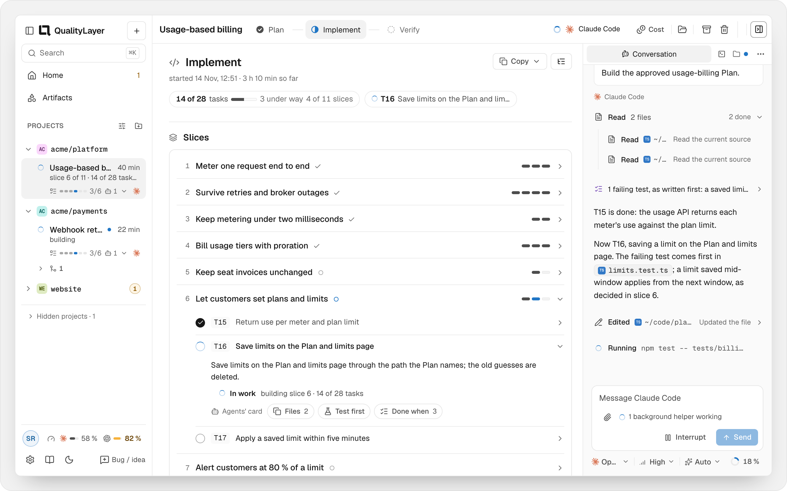
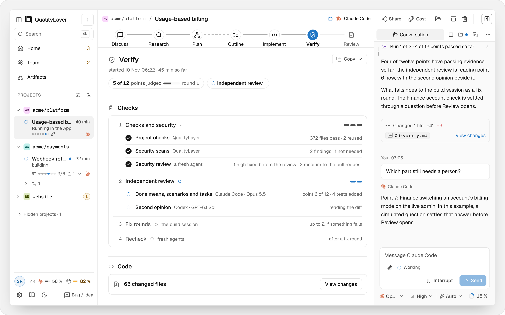
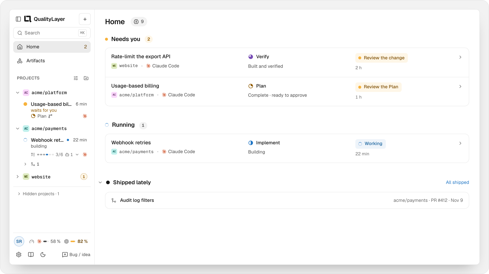

<div align="center">

<picture>
  <source media="(prefers-color-scheme: dark)" srcset="docs/site/public/brand/qualitylayer-mark.svg">
  
</picture>

<h1>QualityLayer<br><sub>The software factory with you in the loop</sub></h1>

**Plan, implement and verify software with your favorite coding agents.**<br>
Work side by side in the App or browser, or in your own agent: terminal, IDE or agent app.

<a href="https://github.com/maxritter/qualitylayer/releases"></a>
<a href="https://github.com/maxritter/qualitylayer/releases"></a>
<a href="https://github.com/maxritter/qualitylayer"></a>

<p>
  <a href="#install">Install</a> •
  <a href="#features">Workflow</a> •
  <a href="https://qualitylayer.dev/docs/">Docs</a> •
  <a href="https://qualitylayer.dev">Website</a> •
  <a href="https://qualitylayer.dev/docs/changelog">Changelog</a> •
  <a href="https://github.com/maxritter/qualitylayer/issues">Issues</a>
</p>

<p>
  <a href="https://qualitylayer.dev/download"><b>Download the App</b></a>&nbsp;&nbsp;
  <picture>
    <source media="(prefers-color-scheme: dark)" srcset="docs/img/os-marks-dark.svg">
    
  </picture>
</p>

<a href="https://qualitylayer-media.max-ritter.workers.dev/overview.mp4"></a>&nbsp;<a href="https://qualitylayer.dev/inside"></a>

<picture>
  <source media="(prefers-color-scheme: dark)" srcset="https://qualitylayer-media.max-ritter.workers.dev/readme-walkthrough-dark-v2026111001.webp">
  
</picture>

<sub>Watch it larger on [qualitylayer.dev](https://qualitylayer.dev) or [try the demo](https://qualitylayer.dev/app-demo/?story&guide) in your browser.</sub>

</div>

---

## Why QualityLayer

> “With QualityLayer, developing software with agents finally feels like doing real engineering again.”
>
> *An engineer who uses QualityLayer*

| You get | How it works |
| --- | --- |
| **Your own agent and plan** | Use Claude Code, Codex, Cursor and more with your existing login or API key. |
| **A design you can review** | Ask your agent about diagrams and clickable screens, then approve the Plan before code changes. |
| **Small, tested changes** | Your agent writes tests before code and hands independent parts to other agents when useful. |
| **An independent check** | With independent review on, a separate agent checks the running change against your request before you review it. |
| **Your own requirements** | Add checks, tools or skills to any step. Your agent records what ran, what did not, and why. [Step checks](https://qualitylayer.dev/docs/reference/settings#step-checks). |
| **Your own automations** | Send task events to a URL or a command, and read or start tasks from a script. [Automations](https://qualitylayer.dev/docs/automations). |
| **Visible decisions and effort** | Read decisions and results in your repository; see time, model usage value and cost estimates in the App. |

---

<h2 id="install">Getting started</h2>

### Prerequisites

- **A coding agent**, installed and signed in with your subscription or API key: Claude Code, Codex, Cursor, Grok, Antigravity, Pi, OpenCode or GitHub Copilot. [Other agents](https://qualitylayer.dev/docs/agents/other) connect through the CLI.
- **Git** and a repository.

### Installation

**[Download the App](https://qualitylayer.dev/download)** and open it. Setup automatically installs the `qualitylayer` command ([commands](https://qualitylayer.dev/docs/reference/commands)) and connects your agents. On a server, in WSL or in a container:

```bash
curl -fsSL https://qualitylayer.dev/install.sh | bash      # macOS, Linux, WSL
irm https://qualitylayer.dev/install.ps1 | iex             # Windows PowerShell
```

The App updates itself; without it, run `qualitylayer update`. To work on a Linux or macOS machine you reach over ssh, add it under **Settings › Machines**: the App installs QualityLayer there and shows its tasks. [Installation guide](https://qualitylayer.dev/docs/install).

<details>
<summary><b>Uninstalling</b></summary>

`qualitylayer uninstall` undoes what the installer changed; your plans stay. On Windows, even when the App is gone:

```powershell
& ([scriptblock]::Create((irm https://qualitylayer.dev/install.ps1))) -Uninstall
```

</details>

<details>
<summary><b>Coming from Pilot Shell 11</b></summary>

Run `pilot update` or download the App. An active Pilot Shell licence works with both products; older purchases may need help moving over. [Migration and memory import](https://qualitylayer.dev/docs/moving-from-pilot-shell).

</details>

### First steps

In the App or browser, choose **+**, then **Task** (Feature or Bugfix) or **Chat**. Pick your repository and agent, and describe what you need:

```text
Plan retries for failed webhooks and stop after a few tries.
```

1. Answer questions and ask your agent to revise the Plan.
2. Approve the Plan. Your agent builds and verifies the change.
3. Review the result and recorded checks, then approve it. Ask your agent to merge, deploy or make further changes.

Prefer your terminal, IDE or agent app? Choose **In my own agent**, or ask there: “Using QualityLayer, plan retries for failed webhooks.” Other agents use the CLI ([supported agents](https://qualitylayer.dev/docs/agents/native)). **Chat** skips the workflow steps ([Chat guide](https://qualitylayer.dev/docs/chat)). QualityLayer runs only when you ask for it. [Your first task](https://qualitylayer.dev/docs/first-task).

### Skills your agent gets

Setup adds these skills. Ask in plain words, in any language.

| Skill | For | You say |
| --- | --- | --- |
| `ql-peer` | Agents talking to each other | “Ask Codex to review what you just built.” |
| `ql-workflow` | Plan, implement and verify a change | “Using QualityLayer, add rate limits to the export API.” |
| `ql-chat` | Chat without workflow steps | “Using QualityLayer, chat about the billing refactor.” |
| `ql-artifact` | Designs, diagrams and pages | “Open the settings design in my browser.” |
| `ql-quality` | Code health and security scans | “Scan this repository for leaked secrets.” |
| `ql-manage` | Tasks, settings and setup | “Show my open tasks.” |

[More about the skills](https://qualitylayer.dev/docs/agents/native#the-six-skills)

---

<h2 id="features">The workflow</h2>

Three steps, two approvals. You plan and you verify; agents do everything between. Each step is one page in the App and one Markdown file in your repository, and existing plans start at Plan.

### 1 · Plan, approved by you

Your agent reads the code, asks what only you can answer and writes one Plan: **Done means** with the steps that prove each point, diagrams and clickable screens. A bug is reproduced and diagnosed here. [Plan guide](https://qualitylayer.dev/docs/steps/plan)

<picture>
  <source media="(prefers-color-scheme: dark)" srcset="docs/site/public/product/plan-dark.webp">
  
</picture>

### 2 · Implement, by your agents

Your agent cuts the Plan into slices and task cards, writes a failing test before each change and hands independent slices to other agents. It builds without a stop. [Implement guide](https://qualitylayer.dev/docs/steps/implement)

<picture>
  <source media="(prefers-color-scheme: dark)" srcset="docs/site/public/product/implement-dark.webp">
  
</picture>

### 3 · Verify, then approved by you

Agents that did not write the code check every point and fix what fails, up to two rounds. Then the same page is your review: the code, the screens and each point as it ran. [Verify guide](https://qualitylayer.dev/docs/steps/verify)

<picture>
  <source media="(prefers-color-scheme: dark)" srcset="docs/site/public/product/verify-dark.webp">
  
</picture>

**Then the pull request.** Your agent fixes failing checks and routine review threads; the task stays open until you merge. [Pull request guide](https://qualitylayer.dev/docs/steps/pull-request)

## Checks and independent review

Your project's checks, [code health](https://qualitylayer.dev/docs/reference/code-health) and security scans run first. Then a separate agent reviews the change against your request. [How Verify works](https://qualitylayer.dev/docs/steps/verify).

<picture>
  <source media="(prefers-color-scheme: dark)" srcset="docs/img/verification-dark.webp">
  
</picture>

## QualityLayer App

<picture>
  <source media="(prefers-color-scheme: dark)" srcset="docs/site/public/product/home-dark.webp">
  
</picture>

| In the App | What you can do |
| --- | --- |
| **Chat or a planned task** | Talk directly with your agent or follow the workflow. See agent activity and get notified when one needs you. |
| **Conversation and terminal** | Read the agent's conversation or its terminal beside the task. Answer questions and prepare contextual requests with Ask agent. |
| **Artifacts** | Try mockups, diagrams and clickable pages before any code exists. Keep reusable ones in your repository. [Artifacts guide](https://qualitylayer.dev/docs/artifacts). |
| **Checks and code review** | Read the evidence and file diffs, and ask your agent about any line. |
| **Agent controls and usage** | Choose model, effort and permissions; track limits and daily costs, including in the macOS menu bar. [Settings](https://qualitylayer.dev/docs/reference/settings). |
| **Local memory** | Reuse [project lessons](https://qualitylayer.dev/docs/memory), with optional project Git export and explicit repository import. |

QualityLayer keeps tasks, Chats, artifacts and memories on machines you control. Your coding agent uses its own provider. [Files and privacy](https://qualitylayer.dev/docs/reference/files#privacy).

[Read about the App](https://qualitylayer.dev/docs/app)

<picture>
  <source media="(prefers-color-scheme: dark)" srcset="docs/site/public/product/artifact-dark.webp">
  
</picture>

---

<div align="center">

**Quality by design.** The software factory with you in the loop.

Made by [Max Ritter](https://maxritter.net) · [License](LICENSE)

</div>

[osai-verify: 8d67182dee08d42091c5]: #
