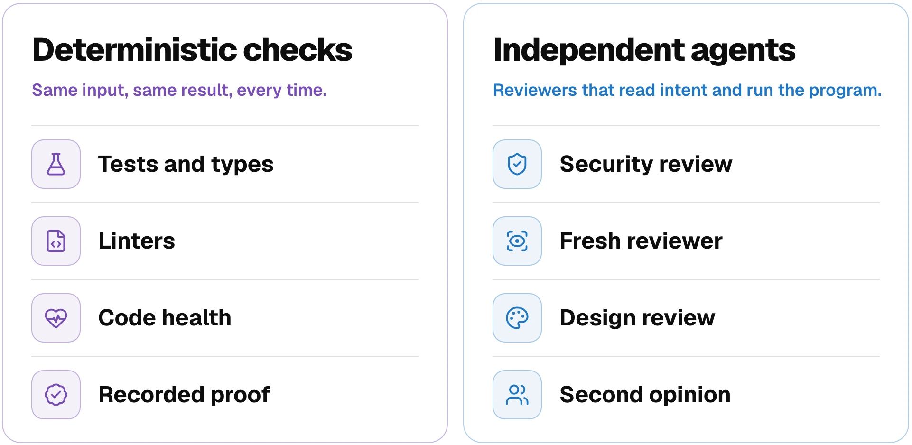
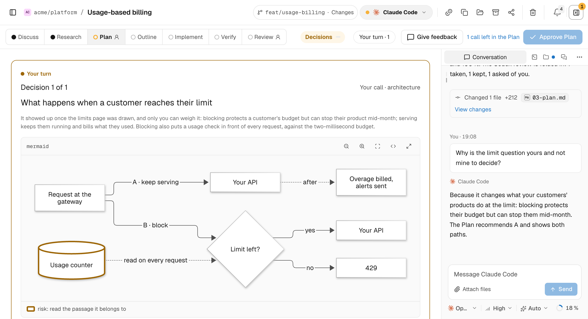
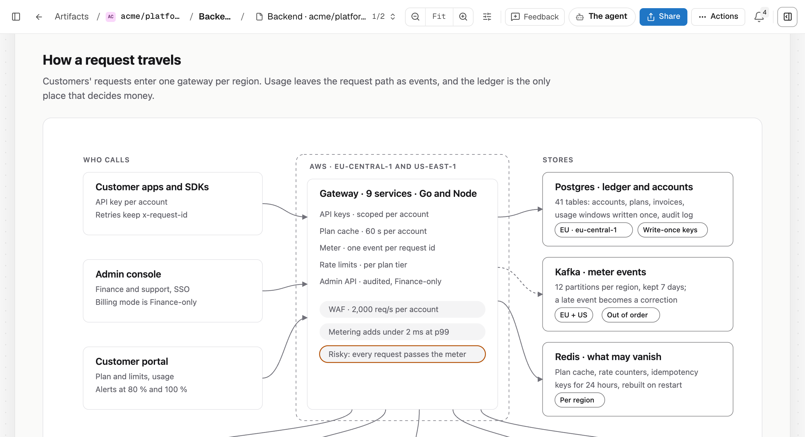

<div align="center">

<picture>
  <source media="(prefers-color-scheme: dark)" srcset="docs/site/public/brand/qualitylayer-mark.svg">
  
</picture>

# QualityLayer

## The software factory with you in the loop

**Plan each change visually, then let your agents build and verify it.**<br>
Work side by side in the App or browser, or use your favourite terminal or IDE.

<a href="https://github.com/maxritter/qualitylayer"></a>
<a href="https://star-history.com/#maxritter/qualitylayer&amp;Date"></a>
<a href="https://github.com/maxritter/qualitylayer/releases"></a>
<a href="https://github.com/maxritter/qualitylayer/pulls"></a>

<p>
  <a href="#install">Install</a> •
  <a href="#features">Features</a> •
  <a href="https://qualitylayer.dev/docs/">Docs</a> •
  <a href="https://qualitylayer.dev">Website</a> •
  <a href="https://qualitylayer.dev/docs/changelog">Changelog</a>
</p>

**[Download the App](https://qualitylayer.dev/download)** for macOS, Windows or Linux.

<a href="https://qualitylayer.dev/inside"></a>

<br>

<a href="https://qualitylayer-media.max-ritter.workers.dev/overview-v2026102001.mp4" aria-label="Watch the QualityLayer walkthrough, 5 minutes 20 seconds"></a>

**[▶ Watch the 5:20 walkthrough](https://qualitylayer-media.max-ritter.workers.dev/overview-v2026102001.mp4)**

</div>

---

## Why QualityLayer

> “With QualityLayer, developing software with agents finally feels like doing real engineering again.”
>
> *An engineer who uses QualityLayer*

QualityLayer keeps design decisions and verification visible while your agents work.

| You get | How it works |
| --- | --- |
| **Your own agent and plan** | Claude Code, Codex, Cursor and four more run on the subscription or API key you already have. |
| **A design you can review** | Comment on diagrams and clickable screens, then approve the Plan before code changes. |
| **Small, tested changes** | Your lead writes tests before code and delegates independent slices when useful. |
| **An independent check** | With independent review on, a separate agent checks the running change against your request. Anything it cannot verify stays visible in Review. |
| **Code health checks** | Find complex functions, deeply nested code and duplication. [Code health](https://qualitylayer.dev/docs/reference/code-health). |
| **Visible decisions and effort** | Each step records its decisions and results in your repository, with time and estimated model cost shown in the App. |

---

<h2 id="install">Getting Started</h2>

### Prerequisites

- **A coding agent**, installed and signed in: Claude Code, Codex, Cursor, Grok, Antigravity, Pi or OpenCode. [Other agents](https://qualitylayer.dev/docs/agents/other) connect through the CLI.
- **Your own subscription** (Claude or ChatGPT plan, or API key).
- **Git** and a repository.

### Installation

**[Download the App](https://qualitylayer.dev/download)** and open it. Setup automatically installs the `qualitylayer` command and connects your agents. On a server, in WSL or in a container:

```bash
curl -fsSL https://qualitylayer.dev/install.sh | bash      # macOS, Linux, WSL
irm https://qualitylayer.dev/install.ps1 | iex             # Windows PowerShell
```

The App updates itself; without it, run `qualitylayer update`. [Installation guide](https://qualitylayer.dev/docs/install).

<details>
<summary><b>Uninstalling</b></summary>

`qualitylayer uninstall` undoes what the installer changed; your plans stay. On Windows, even when the App is gone:

```powershell
& ([scriptblock]::Create((irm https://qualitylayer.dev/install.ps1))) -Uninstall
```

</details>

<details>
<summary><b>Coming from Pilot Shell 11</b></summary>

Run `pilot update` or download the App. Active Polar licences work with both products; older purchases may need help moving over. [Migration and memory import](https://qualitylayer.dev/docs/moving-from-pilot-shell).

</details>

### First Steps

In the App or browser, choose **+ New**, then **Chat**, **Feature** or **Bugfix**. Pick your repository and agent, and describe what you need.

**Chat** is a conversation without workflow steps. You can use artifacts, checks and reviews as needed, then **Start the workflow** from the same conversation. [Chat guide](https://qualitylayer.dev/docs/chat).

For a **Feature** or **Bugfix**, choose **Plan with QualityLayer**, or **Existing plan** to paste or attach a plan. Describe what you want:

```text
Plan retries for failed webhooks and stop after a few tries.
```

1. Answer questions and comment on the Plan.
2. Approve the Plan. Your agent builds and verifies the change.
3. Review the result, including any checks that still need you, and approve it.

| Where you work | How to start |
| --- | --- |
| **App or browser** | Choose **In the App** to keep the agent beside the task. |
| **Your terminal or IDE** | Choose **In my terminal** to copy the request, or ask there: “Using QualityLayer, plan retries for failed webhooks.” |
| **Another agent** | Agents that run shell commands can use the CLI. [Supported agents](https://qualitylayer.dev/docs/agents/native). |

To switch agents or environments, stop the run and ask: “Using QL, continue task retry-webhooks.”

QualityLayer runs only when you ask for it. [Your first task](https://qualitylayer.dev/docs/first-task).

### Skills your agent gets

Setup installs six skills. Ask in plain language, naming QualityLayer or QL; your agent picks the right one.

| Skill | What it does |
| --- | --- |
| `ql-workflow` | Plan, build, verify and review a change |
| `ql-artifact` | Create and revise mockups, diagrams and clickable pages |
| `ql-manage` | Find tasks and manage memory, sharing, settings and setup |
| `ql-peer` | Coordinate other agent sessions on your computer |
| `ql-quality` | Review code complexity, structure and duplication |
| `ql-chat` | Start or continue a Chat, a conversation without workflow steps |

Only `ql-workflow` starts the planning and build workflow; the others work on their own. [More about the skills](https://qualitylayer.dev/docs/agents/native#the-six-skills).

---

## Checks and independent review

QualityLayer runs your project's checks and security scans. A separate agent reviews the change against your request. [How Verify works](https://qualitylayer.dev/docs/steps/verify).

<picture>
  <source media="(prefers-color-scheme: dark)" srcset="docs/img/verification-dark.webp">
  
</picture>

<h2 id="features">The Workflow</h2>

Seven steps take a change from questions to review, with decisions and checks saved as Markdown in your repository. Existing plans start at Plan. You approve the Plan and finished change, authorize pushes and control the merge.

<picture>
  <source media="(prefers-color-scheme: dark)" srcset="docs/docusaurus/static/img/diagrams/flow-pr-dark.svg">
  
</picture>

| Step | What happens |
|---|---|
| [Discuss](https://qualitylayer.dev/docs/steps/discuss) | Settles what done means and clarifies a bug report |
| [Research](https://qualitylayer.dev/docs/steps/research) | Agents read how your code works today; a bug is reproduced and diagnosed here |
| [Plan](https://qualitylayer.dev/docs/steps/plan) | Diagrams, clickable artifacts and checks, **approved by you** |
| [Outline](https://qualitylayer.dev/docs/steps/outline) | The build session splits the approved Plan into small slices |
| [Implement](https://qualitylayer.dev/docs/steps/implement) | Your agent builds test first, fixes what fails and decides when it is ready |
| [Verify](https://qualitylayer.dev/docs/steps/verify) | Your project's checks and an independent agent's review |
| [Review](https://qualitylayer.dev/docs/steps/review) | A walkthrough of the change, **approved by you** |
| [Pull request](https://qualitylayer.dev/docs/steps/pull-request) | Failing checks and routine review threads fixed; the task stays open until you merge |

### Two levels

**Engineering** starts with a technical plan. **Product** starts with a product brief. Choose in Settings › Workflow. [How they differ](https://qualitylayer.dev/docs/#two-levels).

## QualityLayer App

<picture>
  <source media="(prefers-color-scheme: dark)" srcset="docs/site/public/product/plan-dark.webp">
  
</picture>

| In the App | What you can do |
| --- | --- |
| **Chat or a planned task** | Talk directly with your agent or follow the seven-step workflow. |
| **Conversation and terminal** | Read the agent's conversation or its terminal beside the task. Answer questions and pin feedback. |
| **Artifacts** | Try mockups, diagrams and clickable pages before any code exists. |
| **Checks and code review** | Read the evidence and file diffs, and comment on any line. |
| **Agent controls and usage** | Choose your model, effort and permissions; track usage. [Settings](https://qualitylayer.dev/docs/reference/settings). |
| **Memory and team** | Reuse [project lessons](https://qualitylayer.dev/docs/memory), ask teammates over Slack and [share work](https://qualitylayer.dev/docs/team/plans). |

QualityLayer keeps task files on your computer and encrypts shared tasks first. Your coding agent uses its own provider. [Files and privacy](https://qualitylayer.dev/docs/reference/files#privacy).

[Explore the App →](https://qualitylayer.dev/docs/app)

## Artifacts

Try mockups, diagrams and clickable pages before building. Pin feedback to any spot; your agent updates the artifact. Keep reusable artifacts in your repository. [Artifacts guide](https://qualitylayer.dev/docs/artifacts).

<picture>
  <source media="(prefers-color-scheme: dark)" srcset="docs/site/public/product/artifact-dark.webp">
  
</picture>

---

## Documentation

Guides for [getting started](https://qualitylayer.dev/docs/), [commands](https://qualitylayer.dev/docs/reference/commands) and [settings](https://qualitylayer.dev/docs/reference/settings).

---

## Changelog

See [the changelog](https://qualitylayer.dev/docs/changelog) or [GitHub Releases](https://github.com/maxritter/qualitylayer/releases).

---

## Contributing

Found a bug or missing a feature? [Open an issue](https://github.com/maxritter/qualitylayer/issues).

---

## License

See [LICENSE](LICENSE).

---

<div align="center">

**Quality by design.** The software factory with you in the loop.

Made by [Max Ritter](https://maxritter.net)

</div>

[osai-verify: 8d67182dee08d42091c5]: #
