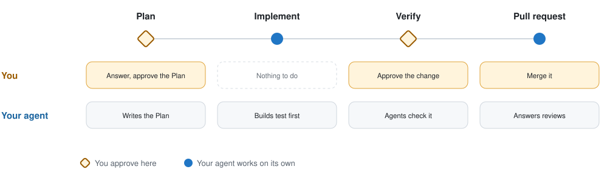
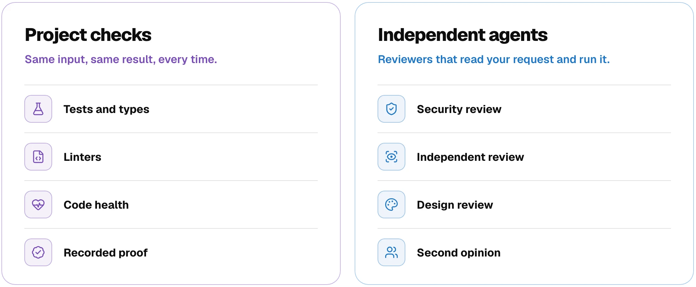
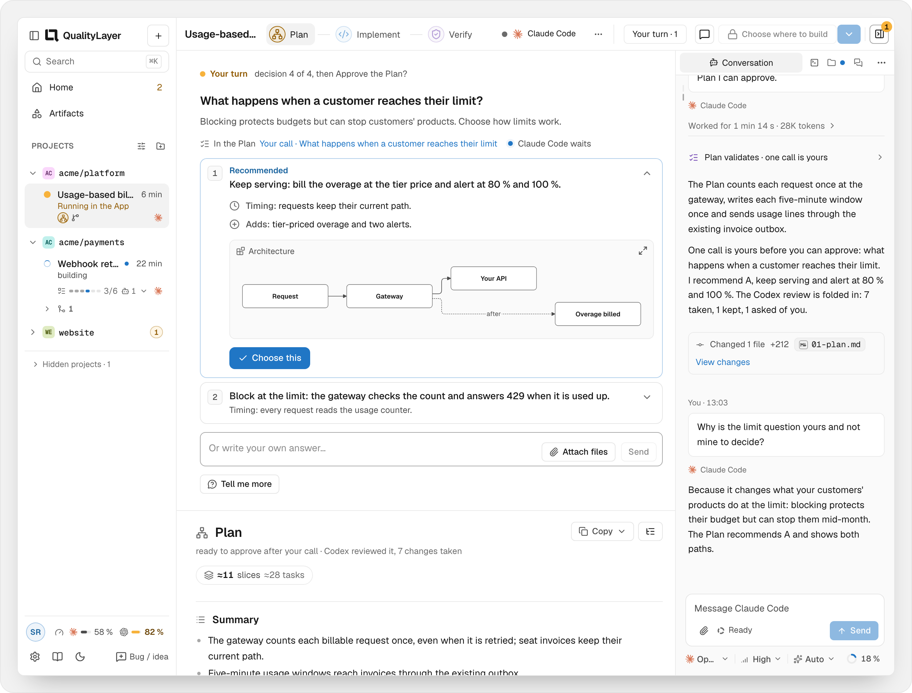
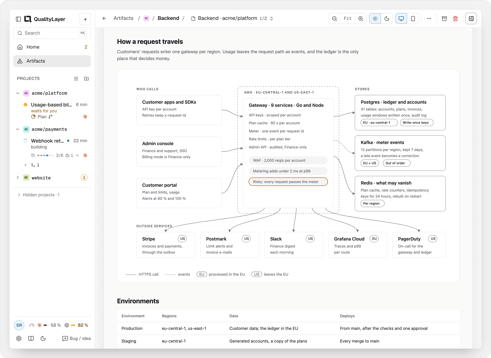

<div align="center">

<picture>
  <source media="(prefers-color-scheme: dark)" srcset="docs/site/public/brand/qualitylayer-mark.svg">
  
</picture>

<h1>QualityLayer<br><sub>The software factory with you in the loop</sub></h1>

**Plan each change visually, then let your agents build and verify it.**<br>
Work side by side in the App or browser, or stay in your terminal or IDE.

<a href="https://github.com/maxritter/qualitylayer/releases"></a>
<a href="https://github.com/maxritter/qualitylayer/releases"></a>
<a href="https://github.com/maxritter/qualitylayer"></a>

<p>
  <a href="#install">Install</a> •
  <a href="#features">Workflow</a> •
  <a href="https://qualitylayer.dev/docs/">Docs</a> •
  <a href="https://qualitylayer.dev">Website</a> •
  <a href="https://qualitylayer.dev/docs/changelog">Changelog</a> •
  <a href="https://github.com/maxritter/qualitylayer/issues">Issues</a>
</p>

<p>
  <a href="https://qualitylayer.dev/download"><b>Download the App</b></a>&nbsp;&nbsp;
  <picture>
    <source media="(prefers-color-scheme: dark)" srcset="docs/img/os-marks-dark.svg">
    
  </picture>
</p>

<a href="https://youtu.be/p1m4O4xRsrQ"></a>&nbsp;<a href="https://qualitylayer.dev/inside"></a>

<picture>
  <source media="(prefers-color-scheme: dark)" srcset="https://qualitylayer-media.max-ritter.workers.dev/readme-walkthrough-dark-v2026110801.webp">
  
</picture>

<sub>Watch it larger on [qualitylayer.dev](https://qualitylayer.dev) or [try the demo](https://qualitylayer.dev/app-demo/?story&guide) in your browser.</sub>

</div>

---

## Why QualityLayer

> “With QualityLayer, developing software with agents finally feels like doing real engineering again.”
>
> *An engineer who uses QualityLayer*

| You get | How it works |
| --- | --- |
| **Your own agent and plan** | Use Claude Code, Codex, Cursor and more with your existing login or API key. |
| **A design you can review** | Comment on diagrams and clickable screens, then approve the Plan before code changes. |
| **Small, tested changes** | Your agent writes tests before code and hands independent parts to other agents when useful. |
| **An independent check** | With independent review on, a separate agent checks the running change against your request before Review opens. |
| **Your own requirements** | Add checks, tools or skills to any step. Your agent records what ran, what did not, and why. [Required lines](https://qualitylayer.dev/docs/required-lines). |
| **Visible decisions and effort** | Read decisions and results in your repository; see time, model usage value and cost estimates in the App. |

---

<h2 id="install">Getting started</h2>

### Prerequisites

- **A coding agent**, installed and signed in with your subscription or API key: Claude Code, Codex, Cursor, Grok, Antigravity, Pi, OpenCode or GitHub Copilot. [Other agents](https://qualitylayer.dev/docs/agents/other) connect through the CLI.
- **Git** and a repository.

### Installation

**[Download the App](https://qualitylayer.dev/download)** and open it. Setup automatically installs the `qualitylayer` command ([commands](https://qualitylayer.dev/docs/reference/commands)) and connects your agents. On a server, in WSL or in a container:

```bash
curl -fsSL https://qualitylayer.dev/install.sh | bash      # macOS, Linux, WSL
irm https://qualitylayer.dev/install.ps1 | iex             # Windows PowerShell
```

The App updates itself; without it, run `qualitylayer update`. [Installation guide](https://qualitylayer.dev/docs/install).

<details>
<summary><b>Uninstalling</b></summary>

`qualitylayer uninstall` undoes what the installer changed; your plans stay. On Windows, even when the App is gone:

```powershell
& ([scriptblock]::Create((irm https://qualitylayer.dev/install.ps1))) -Uninstall
```

</details>

<details>
<summary><b>Coming from Pilot Shell 11</b></summary>

Run `pilot update` or download the App. An active Pilot Shell licence works with both products; older purchases may need help moving over. [Migration and memory import](https://qualitylayer.dev/docs/moving-from-pilot-shell).

</details>

### First steps

In the App or browser, choose **+**, then **Task** (Feature or Bugfix) or **Chat**. Pick your repository and agent, and describe what you need:

```text
Plan retries for failed webhooks and stop after a few tries.
```

1. Answer questions and comment on the Plan.
2. Approve the Plan. Your agent builds and verifies the change.
3. Review the result and recorded checks, then approve it. Ask your agent to merge, deploy or make further changes.

Prefer your terminal or IDE? Choose **In my terminal**, or ask there: “Using QualityLayer, plan retries for failed webhooks.” Other agents use the CLI ([supported agents](https://qualitylayer.dev/docs/agents/native)). **Chat** skips the workflow steps ([Chat guide](https://qualitylayer.dev/docs/chat)). QualityLayer runs only when you ask for it. [Your first task](https://qualitylayer.dev/docs/first-task).

### Skills your agent gets

Setup adds these skills. Ask in plain words, in any language.

| Skill | For | You say |
| --- | --- | --- |
| `ql-peer` | Agents talking to each other | “Ask Codex to review what you just built.” |
| `ql-workflow` | Plan, build and review a change | “Using QualityLayer, add rate limits to the export API.” |
| `ql-chat` | Chat without workflow steps | “Using QualityLayer, chat about the billing refactor.” |
| `ql-artifact` | Designs, diagrams and pages | “Open the settings design in my browser.” |
| `ql-quality` | Code health and security scans | “Scan this repository for leaked secrets.” |
| `ql-manage` | Tasks, sharing, settings, setup | “Share this task with my team.” |

[More about the skills](https://qualitylayer.dev/docs/agents/native#the-six-skills)

---

<h2 id="features">The workflow</h2>

Each step saves readable Markdown in your repository, and existing plans start at Plan. You approve the Plan and the finished change, and you control pushes and merges.

<picture>
  <source media="(prefers-color-scheme: dark)" srcset="docs/docusaurus/static/img/diagrams/flow-pr-dark.svg">
  
</picture>

| Step | What happens |
|---|---|
| [Discuss](https://qualitylayer.dev/docs/steps/discuss) | Settles what done means and clarifies a bug report |
| [Research](https://qualitylayer.dev/docs/steps/research) | Agents read how your code works today; a bug is reproduced and diagnosed here |
| [Plan](https://qualitylayer.dev/docs/steps/plan) | Diagrams, clickable artifacts and the acceptance test, **approved by you** |
| [Outline](https://qualitylayer.dev/docs/steps/outline) | Your agent splits the approved Plan into small slices |
| [Implement](https://qualitylayer.dev/docs/steps/implement) | Your agent builds test first, fixes what fails and decides when it is ready |
| [Verify](https://qualitylayer.dev/docs/steps/verify) | Your project's checks and an independent agent's review |
| [Review](https://qualitylayer.dev/docs/steps/review) | The code first, what changed and the acceptance test as it ran, **approved by you** |
| [Pull request](https://qualitylayer.dev/docs/steps/pull-request) | Failing checks and routine review threads fixed; the task stays open until you merge |

### Two levels

**Engineering** starts with a technical plan. **Product** starts with a product brief. Choose in Settings › Workflow. [How they differ](https://qualitylayer.dev/docs/#two-levels).

## Checks and independent review

Your project's checks, [code health](https://qualitylayer.dev/docs/reference/code-health) and security scans run first. Then a separate agent reviews the change against your request. [How Verify works](https://qualitylayer.dev/docs/steps/verify).

<picture>
  <source media="(prefers-color-scheme: dark)" srcset="docs/img/verification-dark.webp">
  
</picture>

## QualityLayer App

<picture>
  <source media="(prefers-color-scheme: dark)" srcset="docs/site/public/product/plan-dark.webp">
  
</picture>

| In the App | What you can do |
| --- | --- |
| **Chat or a planned task** | Talk directly with your agent or follow the workflow. See agent activity and get notified when one needs you. |
| **Conversation and terminal** | Read the agent's conversation or its terminal beside the task. Answer questions and pin feedback. |
| **Artifacts** | Try mockups, diagrams and clickable pages before any code exists. Keep reusable ones in your repository. [Artifacts guide](https://qualitylayer.dev/docs/artifacts). |
| **Checks and code review** | Read the evidence and file diffs, and comment on any line. |
| **Agent controls and usage** | Choose model, effort and permissions; track limits and daily costs, including in the macOS menu bar. [Settings](https://qualitylayer.dev/docs/reference/settings). |
| **Memory and team** | Reuse [project lessons](https://qualitylayer.dev/docs/memory), ask teammates over Slack or email and [share work](https://qualitylayer.dev/docs/team/plans). |

QualityLayer keeps task files on your computer and encrypts shared tasks first. Your coding agent uses its own provider. [Files and privacy](https://qualitylayer.dev/docs/reference/files#privacy).

[Read about the App](https://qualitylayer.dev/docs/app)

<picture>
  <source media="(prefers-color-scheme: dark)" srcset="docs/site/public/product/artifact-dark.webp">
  
</picture>

---

<div align="center">

**Quality by design.** The software factory with you in the loop.

Made by [Max Ritter](https://maxritter.net) · [License](LICENSE)

</div>

[osai-verify: 8d67182dee08d42091c5]: #
